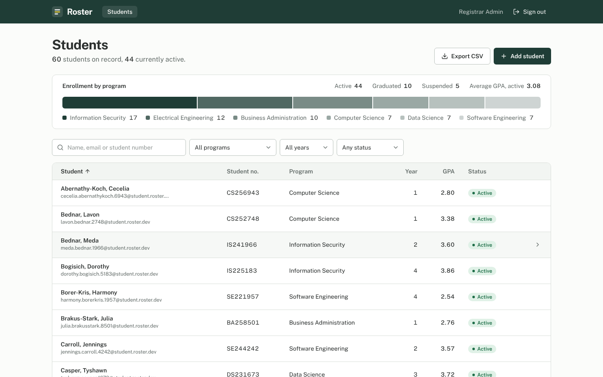
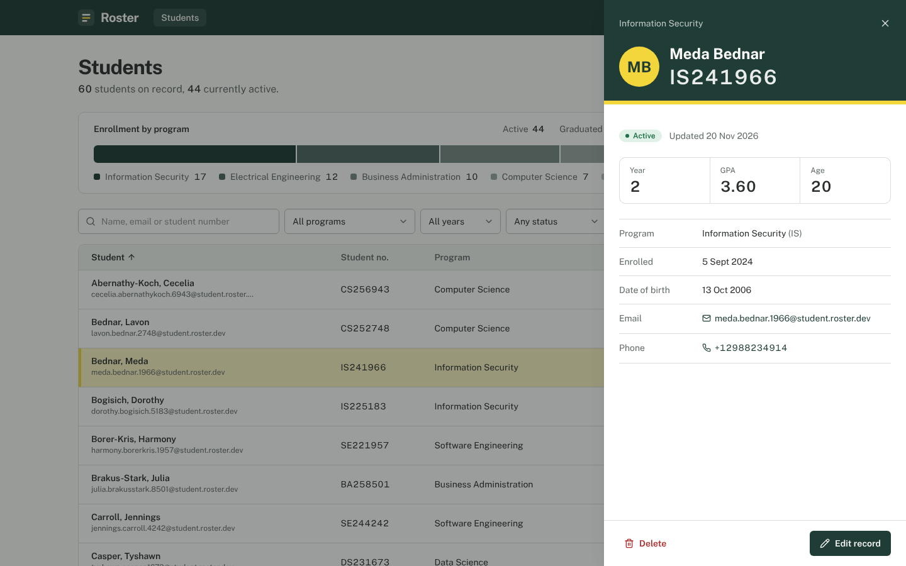
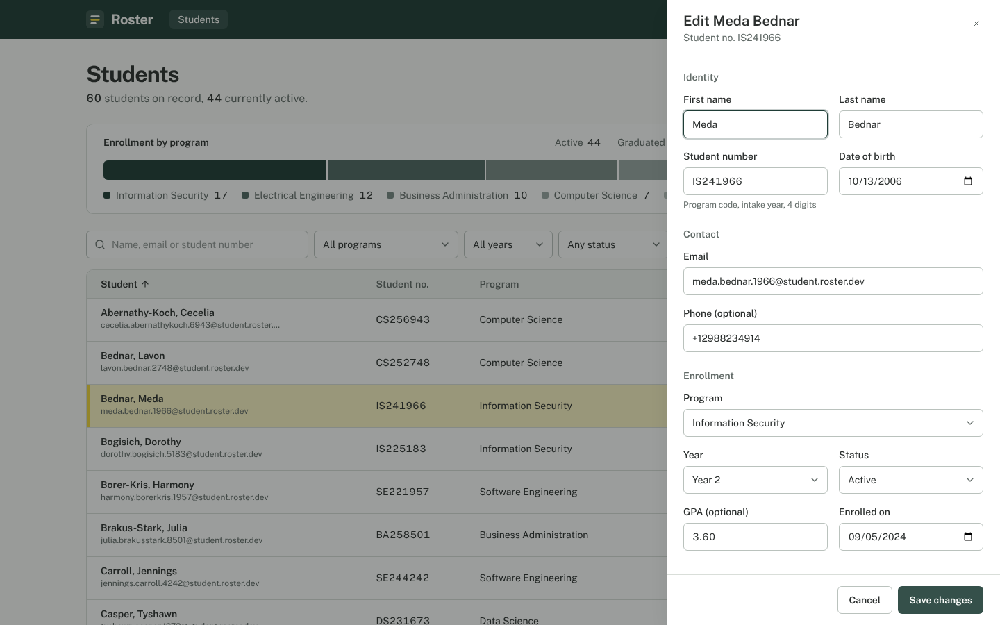
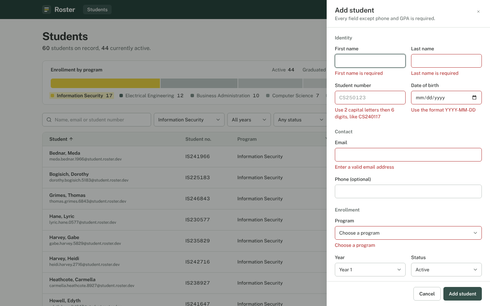
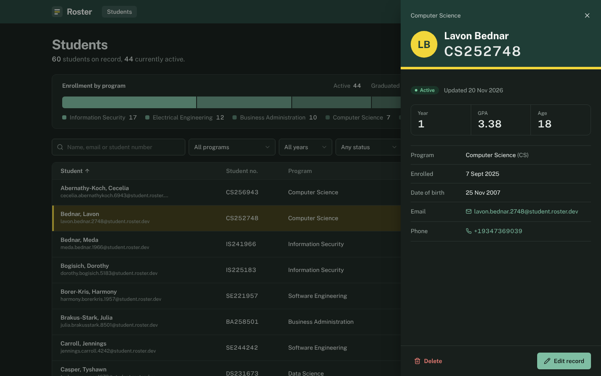
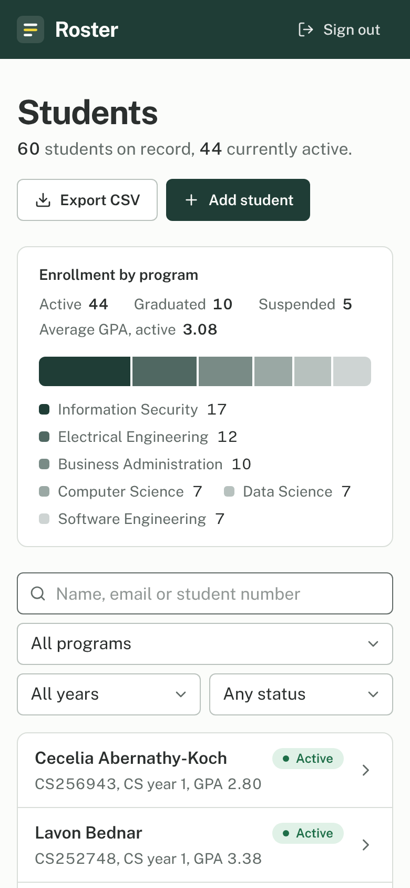

# Roster

A student records system for registrar staff: find any student in a few keystrokes, open their record as an ID card, and add, edit or remove records with full validation.

Built for the **Auspify Technologies Full Stack Development Internship, Task 2 (Student Management System)**.



**Live demo:** _add your Vercel link here_ · **Demo login:** `admin@roster.dev` / `Roster!2026`

## Features

- **Full CRUD.** Add, view, edit and delete student records against PostgreSQL.
- **Search that understands intent.** Every word must match a name, email or student number, so `lina cs24` finds Lina in the 2024 Computer Science intake.
- **Filters and sorting.** Filter by program, year and status, and sort by name, number, year or GPA. All of it lives in the URL, so refresh and the back button keep your place.
- **Enrollment strip.** One bar shows headcount per program. Click a segment to filter the roster to it.
- **ID-card record view.** Each student opens as a card showing number, program, year, GPA, age and contact details.
- **Safe delete.** Deleting is a soft delete with a 6-second **Undo**.
- **Validation in one place.** A single Zod schema validates the form in the browser and the API on the server. Server-only errors, like a duplicate email, appear under the right field.
- **CSV export** of exactly what's filtered, protected against spreadsheet formula injection.
- **Works everywhere.** Responsive down to 360 px, light and dark themes, keyboard accessible, and respects reduced motion.

| | |
| --- | --- |
|  |  |
|  |  |

<p align="center"></p>

## Stack

| Layer | Choice |
| --- | --- |
| Frontend | React 19, Vite, TypeScript, Tailwind CSS, TanStack Query, React Hook Form, Radix UI |
| Backend | Node.js 20, Express 5, TypeScript |
| Database | PostgreSQL 16 with Drizzle ORM and SQL migrations |
| Auth | argon2 password hashes, JWT in an httpOnly cookie |
| Validation | Zod schemas shared by client and server (`shared/`) |
| Tests | Vitest + Supertest (16 API tests), GitHub Actions CI |

## Project structure

```
roster/
├── client/            React app (Vite)
│   └── src/
│       ├── app/           routing, app shell
│       ├── components/ui/ Button, fields, drawer, dialogs, toasts
│       ├── features/      auth/, students/
│       ├── lib/api.ts     fetch wrapper with typed errors
│       └── styles/        design tokens + Tailwind
├── server/            Express API
│   ├── src/
│   │   ├── db/            Drizzle schema, migrate, seed
│   │   ├── middleware/    auth, validate, error handler
│   │   └── modules/       auth, students, programs, stats
│   ├── drizzle/           SQL migrations
│   └── tests/
├── shared/            Zod schemas and types used by both sides
└── docs/screenshots/
```

## Run it locally

You need Node.js 20+ and either Docker or a local PostgreSQL.

```bash
npm install                                  # installs client, server and shared
docker compose up -d                         # Postgres on :5432 (creates roster + roster_test)
cp server/.env.example server/.env           # then set JWT_SECRET (command is in the file)
npm run db:migrate && npm run db:seed        # tables + 60 sample students
npm run dev                                  # API on :4000, app on http://localhost:5173
```

Run the tests with `npm test` (uses the `roster_test` database; see `server/.env.test`).

## API

All routes except login need a signed-in admin. Errors share one shape: `{ "error": { "code", "message", "fields?" } }`.

| Method | Route | Purpose |
| --- | --- | --- |
| POST | `/api/auth/login` | Sign in (rate-limited: 10 tries per 15 min) |
| POST | `/api/auth/logout` | Sign out |
| GET | `/api/auth/me` | Current user |
| GET | `/api/students?search=&programId=&year=&status=&sort=&order=&page=&limit=` | Filtered, paginated list |
| GET | `/api/students/:id` | One student |
| POST | `/api/students` | Create (201, or 400 / 409 with field errors) |
| PATCH | `/api/students/:id` | Update the fields sent |
| DELETE | `/api/students/:id` | Soft delete (204) |
| POST | `/api/students/:id/restore` | Undo a delete |
| GET | `/api/students/export.csv?…` | CSV of the current filter |
| GET | `/api/programs` | Programs with student counts |
| GET | `/api/stats` | Totals by status and program, average GPA |

## Deploy

1. **Database:** create a free Postgres on [Neon](https://neon.tech) and copy its connection string.
2. **API on Render:** connect the repo (it reads `render.yaml`). Set `DATABASE_URL`, and set `CLIENT_ORIGIN` to your Vercel URL. `npm start` runs migrations before booting. Seed once from your machine with `DATABASE_URL=<neon url> npm run db:seed -w server`.
3. **App on Vercel:** set the root directory to `client` and `VITE_API_URL` to the Render URL.

Render's free tier sleeps when idle, so the first request after a while can take about 30 seconds.

## Security

See [SECURITY.md](SECURITY.md) for what is protected and how.

---

Built by M'hammed Mazin · [github.com/Mazine01](https://github.com/Mazine01) · #Auspify #AuspifyInternship
